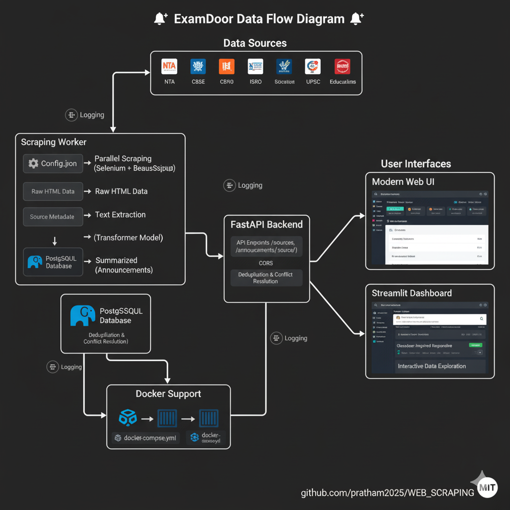
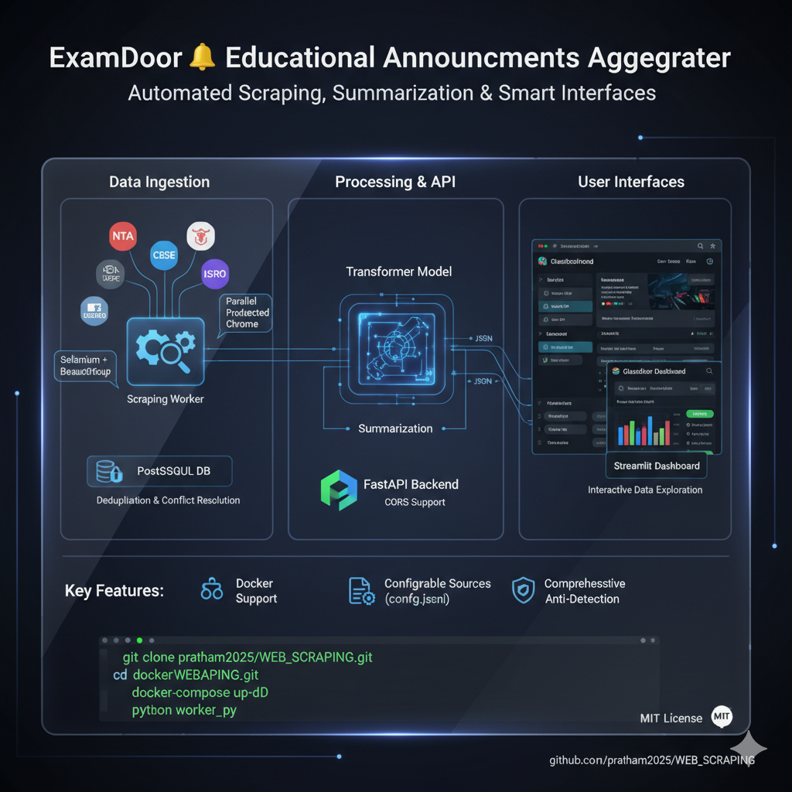

# 📢 ExamDoor – Educational Announcements Aggregator  

🚀 **Automated Scraping, Summarization & Smart Interfaces for Indian Educational Portals**  

[](LICENSE)  
  
  
  
  
  

---

## 🔎 What is ExamDoor?
ExamDoor is a **full-stack system** that continuously scrapes announcements from **12+ major Indian educational portals** (NTA, CBSE, UPSC, ISRO, etc.), summarizes them using a Transformer model, and provides **modern interfaces** for browsing:  

- 📡 **Automated Parallel Scraping** with Selenium + BeautifulSoup  
- 🧠 **Transformer-based Summarization** for announcements  
- 🗄️ **PostgreSQL Database** with deduplication & conflict resolution  
- ⚡ **FastAPI Backend** with REST endpoints + CORS  
- 💻 **Modern Web UI** (Glassdoor-inspired)  
- 📊 **Streamlit Dashboard** for interactive exploration  
- 🐳 **Docker Support** for easy deployment  

---

## 📊 Data Flow (Architecture)  
Here’s how ExamDoor works end-to-end:



---

## 🧩 System Overview  
From scraping to UI — the big picture:



---

## ✨ Features
- ⚡ **Parallel Scraping** of 12+ official portals  
- 🔄 **Summarization via Transformers** for faster scanning  
- 📉 **Result Capping** (60 per source per cycle)  
- 🛡️ **Anti-Detection Chrome Driver** to bypass blocking  
- 🔍 **Search, Filter & Pagination** in UI  
- 🐳 **One-Click Docker Deployment**  
- 📝 **Comprehensive Logging & Error Handling**  

---

## 🏫 Supported Educational Sources
- NTA, CBSE, NEET, JEE, GATE, UPSC, ISRO  
- MAHACET, MPSC, RRB (Mumbai, Kolkata, Ahmedabad)  

---

## ⚙️ Quick Start

### 1️⃣ Clone the Repository
```bash
git clone https://github.com/pratham2025/WEB_SCRAPING.git
cd WEB_SCRAPING
```

### 2️⃣ Install Dependencies
```bash
pip install -r requirements.txt
```

### 3️⃣ Start PostgreSQL (via Docker recommended)
```bash
docker-compose up -d
```

### 4️⃣ Run the Scraper
```bash
python worker.py
```

### 5️⃣ Start the Backend
```bash
uvicorn scraper_api:app --reload --host 127.0.0.1 --port 8000
```

### 6️⃣ Explore the Dashboards
```bash
# Streamlit Dashboard
streamlit run frontend/app.py
```
- 🌐 Modern Web UI → Open `frontend/index.html`  

---

## 📡 API Endpoints

### `GET /sources`
Returns list of sources in DB.

### `GET /announcements/{source}`
Fetches announcements + summaries for given source.  

---

## 🗄️ Database Schema
```sql
CREATE TABLE announcements (
    id SERIAL PRIMARY KEY,
    source VARCHAR(50) NOT NULL,
    text TEXT NOT NULL,
    link TEXT NOT NULL,
    summary TEXT,
    created_at TIMESTAMP DEFAULT CURRENT_TIMESTAMP,
    UNIQUE(source, text)
);
```

---

## 🐳 Docker Deployment
```bash
docker build -t examdoor .
docker run -p 8000:8000 --network host examdoor
```

---

## 🛠️ Troubleshooting
- ✅ Ensure Chrome & ChromeDriver installed (auto-managed)  
- ✅ Check PostgreSQL running with correct credentials  
- ✅ Logs available for worker, API, and UI  

---

## 📜 License
This project is licensed under the **MIT License**.  

👨‍💻 Author: [pratham2025](https://github.com/pratham2025)  

---

✨ *Tip*: Run **FastAPI backend** + **PostgreSQL** before using UIs for smooth experience.  
