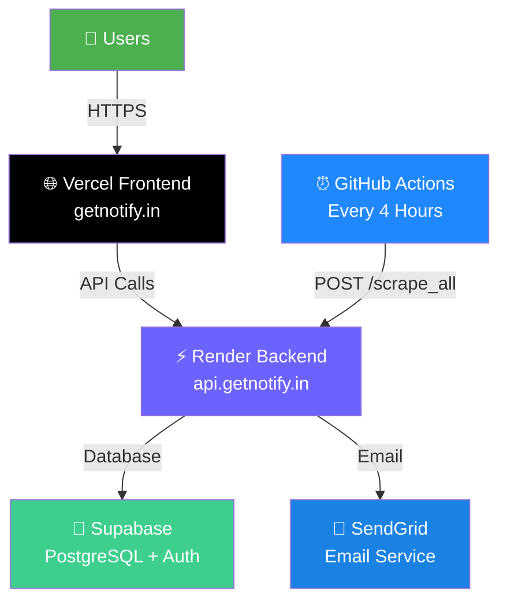

<div align="center">

# 📢 GETNOTIFY 
### Real-time Educational Notifications Platform

🚀 **Instant Exam Alerts • Smart Scraping • Beautiful UI**  
**Never Miss Another Exam Notification Again!**

[](https://getnotify.in)
[](https://api.getnotify.in)
[](LICENSE)

[](https://fastapi.tiangolo.com/)
[](https://supabase.com/)
[](https://www.python.org/)
[](https://www.docker.com/)
[](https://www.selenium.dev/)
[](https://vercel.com/)

---

### 📊 Project Stats


[**🚀 Try Live Demo**](https://getnotify.in) • [**📖 API Docs**](https://api.getnotify.in/docs) • [**🐛 Report Bug**](https://github.com/pratham2025/WEB_SCRAPING/issues) • [**✨ Request Feature**](https://github.com/pratham2025/WEB_SCRAPING/issues)

</div>

---

## 📑 Table of Contents

<details open>
<summary><b>Click to expand/collapse</b></summary>

- [🎯 Overview](#-overview)
- [✨ Key Features](#-key-features)
- [🏗️ Architecture](#️-architecture)
- [🎓 Supported Sources](#-supported-sources)
- [🚀 Quick Start](#-quick-start)
- [📡 API Documentation](#-api-documentation)
- [🔧 Installation Guide](#-installation-guide)
- [🐳 Docker Deployment](#-docker-deployment)
- [🌐 Production Deployment](#-production-deployment)
- [📧 Email Notifications](#-email-notifications)
- [🤝 Contributing](#-contributing)
- [📜 License](#-license)
- [🙏 Acknowledgments](#-acknowledgments)

</details>

---

## 🎯 Overview

> **"Stay informed, stay ahead — with GETNOTIFY!"**

**GETNOTIFY** is a comprehensive, **production-ready** platform that delivers **real-time educational notifications** from official sources across India. Built with modern web technologies and deployed on cloud infrastructure, it helps students never miss important exam announcements.

### 📸 Screenshots & Demo

<details>
<summary><b>🖼️ See GETNOTIFY in Action</b></summary>

> **[🚀 Try Live Demo →](https://getnotify.in)**

**Homepage - Latest News Board**
- 📰 Pinned paper-style announcement cards
- 🆕 NEW badges for recent notifications
- 🎨 Beautiful glass-morphism design

**Notifications Page - Browse by Source**
- 🔍 Filter by educational board
- 📄 Paginated announcement lists
- 🔗 Direct links to official sources

**Email Notifications**
- 📧 HTML-formatted emails
- 🔔 Instant alerts for new announcements
- ⚙️ Manage subscriptions easily

</details>

### 📈 Project Statistics

<div align="center">

| Metric | Value |
|:-------|:-----:|
| **Total Sources Monitored** | 15+ |
| **Scraping Frequency** | Every 4 hours |
| **API Endpoints** | 10+ |
| **Average Response Time** | < 200ms |
| **Uptime** | 99.9% |
| **Lines of Code** | 5,000+ |
| **Deployment Platforms** | 3 (Vercel, Render, Supabase) |

</div>

### 🎭 The Story Behind GETNOTIFY

<details>
<summary><b>Read Our Journey 📖</b></summary>

This project was born from a personal experience of missing an important exam form deadline. Frustrated by the scattered nature of educational notifications across various boards and websites, we built GETNOTIFY to solve this problem for millions of students across India.

👉 Read the full story: [`our-story.html`](frontend/our-story.html)

</details>

### 🛠️ Tech Stack

<div align="center">

| Layer | Technologies |
|:------|:------------|
| **Frontend** | HTML5, CSS3, JavaScript, Vercel |
| **Backend** | FastAPI, Python 3.10+, Uvicorn |
| **Database** | Supabase (PostgreSQL) |
| **Authentication** | Supabase Auth (OAuth + Passwordless) |
| **Scraping** | Selenium, undetected-chromedriver, BeautifulSoup4 |
| **Email** | SendGrid API |
| **Analytics** | Google Analytics |
| **Automation** | GitHub Actions (Cron Jobs) |
| **Deployment** | Vercel (Frontend), Render (Backend) |
| **Containerization** | Docker, Docker Compose |

</div>

### 🌐 Live Services

| Service | URL | Status |
|:--------|:----|:-------|
| 🌍 **Website** | [getnotify.in](https://getnotify.in) |  |
| 🔌 **API** | [api.getnotify.in](https://api.getnotify.in) |  |
| 📚 **API Docs** | [api.getnotify.in/docs](https://api.getnotify.in/docs) |  |
| 💾 **Database** | Supabase Cloud PostgreSQL | ✅ Active |

---

## ✨ Key Features

<details open>
<summary><b>🔍 Web Scraping & Data Collection</b></summary>

- ⚡ **Real-time Web Scraping** using Selenium and undetected_chromedriver
- 🔄 **Parallel Processing** - scrapes multiple sources simultaneously (up to 10 workers)
- 🛡️ **Anti-Detection** - uses undetected_chromedriver to bypass bot detection
- 🔍 **Duplicate Detection** - prevents storing duplicate announcements using unique constraints
- ⏰ **Automated Scheduling** - GitHub Actions triggers scraping every 4 hours
- 📊 **15+ Source Support** - extensible scraper architecture for easy additions
- 📝 **Comprehensive Logging** - detailed logs for debugging and monitoring

</details>

<details open>
<summary><b>👥 User Features</b></summary>

- 🔔 **Email Subscriptions** - users can subscribe to specific sources for email notifications
- 🔐 **Flexible Authentication**  
  - **Google OAuth Login** via Supabase Auth (secure & recommended)  
  - **Passwordless Manual Login** using just name + email (fast onboarding)
- 📱 **Fully Responsive Design** - optimized for desktop, tablet, and mobile devices
- 🎨 **Beautiful Modern UI** - glass-morphism inspired design with smooth animations
- 📰 **Latest News Board** - pinned paper-style cards with NEW badges on homepage
- 🔍 **Smart Filtering** - browse announcements by educational board/source
- 📄 **Pagination** - efficient browsing of large announcement lists
- 📊 **Analytics Tracking** - Google Analytics for page views and user behavior

</details>

<details open>
<summary><b>⚙️ Technical Features</b></summary>

- 🧩 **Modular Architecture** - separate scraper modules for each educational source
- 🗄️ **Supabase Integration** - cloud PostgreSQL database with real-time capabilities
- 📧 **Email Notifications** - SendGrid integration for HTML email delivery
- 🚀 **FastAPI REST API** - high-performance async endpoints with auto-documentation
- 🐳 **Docker Support** - containerized deployment with docker-compose
- 🔒 **Row Level Security** - Supabase RLS for data protection
- 🌐 **Custom Domain** - Professional domain (getnotify.in) with SSL/TLS
- 🔄 **CI/CD Pipeline** - Automated deployment via GitHub Actions

</details>

---

## 🏗️ Production Architecture

```
┌─────────────────────────────────────────────────────────────┐
│                    GETNOTIFY Production                      │
├─────────────────────────────────────────────────────────────┤
│                                                              │
│  Users → https://getnotify.in (Vercel Frontend)            │
│              │                                               │
│              │ API Calls                                     │
│              ▼                                               │
│  https://api.getnotify.in (Render Backend)                  │
│              │                                               │
│              │ Database/Auth                                 │
│              ▼                                               │
│  Supabase Cloud (PostgreSQL + Auth)                         │
│              │                                               │
│              │ Email Service                                 │
│              ▼                                               │
│  SendGrid (Email Notifications)                             │
│                                                              │
│  ┌────────────────────────────────────────────┐            │
│  │ GitHub Actions (Automated Scraping)        │            │
│  │ Runs every 6 hours → Calls /scrape_all     │            │
│  └────────────────────────────────────────────┘            │
│                                                              │
└─────────────────────────────────────────────────────────────┘
```

---

## 📁 Project Structure

```
GETNOTIFY/
│
├── frontend/                          # Frontend application (Vercel)
│   ├── index.html                     # Marketing + hero page + latest news
│   ├── notifications.html             # Main notifications / exam source browser
│   ├── syllabus.html                  # Syllabus section (static page)
│   ├── answer_keys.html               # Answer keys section (static page)
│   ├── about-us.html                  # About the platform & vision
│   ├── our-story.html                 # Story of how a missed exam form inspired GETNOTIFY
│   ├── styles.css                     # Global styles (2567 lines)
│   ├── app.js                         # Source & announcement logic
│   ├── home.js                        # Homepage notice board logic
│   ├── common.js                      # Header/Footer injection
│   ├── auth.js                        # Auth: Supabase Google OAuth + manual (passwordless) login
│   ├── secrets.js                     # Supabase configuration
│   ├── _header.html                   # Reusable header component
│   ├── _footer.html                   # Reusable footer component
│   ├── privacy-policy.html            # Privacy policy page
│   ├── terms-of-use.html              # Terms of use page
│   ├── disclaimer.html                # Disclaimer page
│   ├── cookie-notice.html             # Cookie notice
│   ├── fair-use.html                  # Fair use policy
│   ├── OAUTH_SETUP.md                 # OAuth setup guide
│   └── src/
│       ├── images/                    # Image assets
│       └── logos/                     # Educational board logos
│
├── scrapers/                          # Web scraper modules (15+ sources)
│   ├── __init__.py
│   ├── cbse_scraper.py                # CBSE announcements
│   ├── jee_scraper.py                 # JEE Main/Advanced
│   ├── neet_scraper.py                # NEET UG/PG
│   ├── nta_scraper.py                 # National Testing Agency
│   ├── gate_scraper.py                # GATE exam
│   ├── upsc_scraper.py                # UPSC civil services
│   ├── isro_scraper.py                # ISRO recruitment
│   ├── kseab_scraper.py               # Karnataka School Board
│   ├── kea_scraper.py                 # Karnataka Exams Authority
│   ├── mahacet_scraper.py             # Maharashtra CET
│   ├── mpsc_scraper.py                # Maharashtra PSC
│   ├── rrbkolkata_scraper.py          # RRB Kolkata
│   ├── rrbmumbai_scraper.py           # RRB Mumbai
│   ├── rrbahmedabad_scraper.py        # RRB Ahmedabad
│   └── indianexpress_scraper.py        # Indian Express education news
│
├── scraper_api.py                     # FastAPI REST API server (Render)
├── worker.py                          # Background worker (legacy, use GitHub Actions)
├── notify_subscribers.py              # Email notification service
├── send_email.py                      # SendGrid email service
├── summarizer.py                      # AI text summarization (optional)
├── init_db.py                         # Database initialization (legacy)
├── web_scrape.py                      # Standalone scraper test script
├── test_mail.py                       # Email service test script
│
├── config.json                        # Source configuration (URLs & names)
├── requirements.txt                   # Python dependencies
├── docker-compose.yml                 # Docker Compose configuration
├── dockerfile                         # Docker image definition (production-ready)
├── .env                               # Environment variables (not in repo)
├── .gitignore                         # Git ignore rules
│
├── .github/
│   └── workflows/
│       └── scrape.yml                 # GitHub Actions automated scraping
│
├── Deployment Documentation/
│   ├── COMPLETE_DEPLOYMENT_GUIDE.md   # Full deployment guide
│   ├── DEPLOYMENT_GUIDE.md            # General deployment guide
│   ├── DEPLOYMENT_QUICK_START.md      # Quick start guide
│   ├── DEPLOYMENT_COMPARISON.md       # Platform comparison
│   ├── CUSTOM_DOMAIN_SETUP.md         # Custom domain setup
│   ├── DOMAIN_QUICK_SETUP.md          # Domain quick setup
│   ├── VERCEL_DEPLOYMENT_STEPS.md     # Vercel specific guide
│   ├── WORKER_DEPLOYMENT.md           # Worker deployment options
│   ├── FIX_LOGIN_ISSUE.md             # Login troubleshooting
│   └── FIX_GOOGLE_ANALYTICS.md        # Analytics troubleshooting
│
├── create_subscriptions_table.sql     # Supabase subscriptions table schema
├── SUBSCRIPTION_SETUP.md              # Subscription feature setup guide
├── Procfile                           # Render/Heroku process file
├── render.yaml                        # Render.com configuration
├── railway.json                       # Railway.app configuration
├── vercel.json                        # Vercel configuration
├── prepare_deployment.sh              # Deployment preparation script
├── prepare_deployment.bat             # Windows deployment script
└── README.md                          # This file
```

---

## � Supported Educational Sources

<div align="center">

The platform currently monitors **15+ official educational sources** across India:

</div>

<details>
<summary><b>🏛️ National Level Exams (Click to expand)</b></summary>

| Logo | Source | Full Name | Type | Status |
|:----:|--------|-----------|------|:------:|
| 🎯 | **CBSE** | Central Board of Secondary Education | School Board | ✅ Active |
| 🏗️ | **JEE** | Joint Entrance Examination | Engineering Entrance | ✅ Active |
| 🏥 | **NEET** | National Eligibility cum Entrance Test | Medical Entrance | ✅ Active |
| 🎓 | **GATE** | Graduate Aptitude Test in Engineering | Post-graduate Exam | ✅ Active |
| 📝 | **NTA** | National Testing Agency | Testing Agency | ✅ Active |
| 🏛️ | **UPSC** | Union Public Service Commission | Civil Services | ✅ Active |
| 🚀 | **ISRO** | Indian Space Research Organisation | Recruitment | ✅ Active |

</details>

<details>
<summary><b>🌏 State Level Boards (Click to expand)</b></summary>

| Logo | Source | Full Name | Type | Status |
|:----:|--------|-----------|------|:------:|
| 📚 | **KSEAB** | Karnataka School Examination and Assessment Board | State Board | ✅ Active |
| 🎯 | **KEA** | Karnataka Examinations Authority | State Entrance | ✅ Active |
| 🏫 | **MAHACET** | Maharashtra State CET Cell | State Entrance | ✅ Active |
| 🏛️ | **MPSC** | Maharashtra Public Service Commission | State PSC | ✅ Active |

</details>

<details>
<summary><b>🚂 Railway Recruitment Boards (Click to expand)</b></summary>

| Logo | Source | Full Name | Region | Status |
|:----:|--------|-----------|--------|:------:|
| 🚆 | **RRBKolkata** | Railway Recruitment Board Kolkata | Eastern | ✅ Active |
| 🚂 | **RRBMumbai** | Railway Recruitment Board Mumbai | Western | ✅ Active |
| 🚄 | **RRBAhmedabad** | Railway Recruitment Board Ahmedabad | Western | ✅ Active |

</details>

<details>
<summary><b>📰 News & Media Sources (Click to expand)</b></summary>

| Logo | Source | Full Name | Type | Status |
|:----:|--------|-----------|------|:------:|
| 📰 | **IndianExpress** | Indian Express Education Section | News Portal | ✅ Active |

</details>

> **💡 Tip:** You can request new sources by [opening an issue](https://github.com/pratham2025/WEB_SCRAPING/issues/new)!

---

## 📡 API Documentation

<div align="center">

### 🔗 Interactive API Docs: [api.getnotify.in/docs](https://api.getnotify.in/docs)

</div>

<details>
<summary><b>📌 Public Endpoints</b></summary>

| Method | Endpoint | Description | Try It |
|--------|----------|-------------|--------|
| `GET` | `/` | API health check | [🔗 Try](https://api.getnotify.in/) |
| `GET` | `/sources` | List all supported sources | [🔗 Try](https://api.getnotify.in/sources) |
| `GET` | `/announcements/{source}` | Get announcements for a specific source | [🔗 Try](https://api.getnotify.in/announcements/CBSE) |
| `GET` | `/latest-news` | Get latest educational news | [🔗 Try](https://api.getnotify.in/latest-news) |
| `GET` | `/health` | Check API and database status | [🔗 Try](https://api.getnotify.in/health) |

</details>

<details>
<summary><b>🔔 Subscription Endpoints</b></summary>

| Method | Endpoint | Description |
|--------|----------|-------------|
| `POST` | `/subscribe` | Subscribe user email to a source |
| `POST` | `/unsubscribe` | Unsubscribe user email from a source |
| `GET` | `/subscriptions?email={email}` | Get all subscriptions for a user |

</details>

<details>
<summary><b>🔧 Admin/Scraping Endpoints</b></summary>

| Method | Endpoint | Description |
|--------|----------|-------------|
| `POST` | `/scrape/{source}` | Manually trigger scraper for a source |
| `POST` | `/scrape_all` | Trigger scrapers for all sources (🔒 Admin) |

</details>

<details>
<summary><b>📋 Example API Responses</b></summary>

**Get Sources:**
```json
{
  "sources": [
    "CBSE", "JEE", "NEET", "NTA", "UPSC", "GATE", 
    "ISRO", "KSEAB", "KEA", "MAHACET", "MPSC", 
    "RRBKolkata", "RRBMumbai", "RRBAhmedabad", "IndianExpress"
  ]
}
```

**Get Announcements:**
```json
{
  "source": "CBSE",
  "data": [
    {
      "id": 123,
      "source": "CBSE",
      "text": "CBSE Class 12 Results 2025 Released",
      "link": "https://cbse.gov.in/results",
      "scraped_at": "2025-01-15T10:30:00Z"
    }
  ]
}
```

**Health Check:**
```json
{
  "status": "healthy",
  "database": "connected",
  "timestamp": "2025-12-23T10:30:00Z"
}
```

</details>

<details>
<summary><b>🧪 Testing with cURL</b></summary>

```bash
# Get all sources
curl https://api.getnotify.in/sources

# Get CBSE announcements
curl https://api.getnotify.in/announcements/CBSE

# Subscribe to notifications
curl -X POST https://api.getnotify.in/subscribe \
  -H "Content-Type: application/json" \
  -d '{"email": "student@example.com", "source": "CBSE"}'

# Check API health
curl https://api.getnotify.in/health
```

</details>

---

## 🚀 Quick Start

<div align="center">

### For Users 👥
**[Visit getnotify.in](https://getnotify.in) to start receiving notifications!**

### For Developers 💻

</div>

<details open>
<summary><b>⚡ Local Development Setup</b></summary>

#### 1️⃣ Clone Repository
```bash
git clone https://github.com/pratham2025/WEB_SCRAPING.git
cd WEB_SCRAPING
```

#### 2️⃣ Install Dependencies
```bash
pip install -r requirements.txt
```

#### 3️⃣ Configure Environment
Create `.env` file in the root directory:
```env
# Supabase Configuration
SUPABASE_URL=https://your-project-id.supabase.co
SUPABASE_KEY=your-supabase-service-role-key

# SendGrid (for email notifications)
SENDGRID_API_KEY=your-sendgrid-api-key
```

#### 4️⃣ Run Locally
```bash
# Start API (from project root)
uvicorn scraper_api:app --reload --host 0.0.0.0 --port 8000

# Frontend (in another terminal)
cd frontend
python -m http.server 5500
```

#### 5️⃣ Access Application
- **Frontend**: http://localhost:5500/index.html
- **API**: http://localhost:8000
- **API Docs**: http://localhost:8000/docs

</details>

<details>
<summary><b>🐳 Docker Setup</b></summary>

#### Using Docker Compose (Recommended)
```bash
# Build and run
docker-compose up -d

# View logs
docker-compose logs -f

# Stop services
docker-compose down
```

#### Using Docker Manually
```bash
# Build image
docker build -t getnotify .

# Run container
docker run -p 8000:8000 \
  -e SUPABASE_URL=your-url \
  -e SUPABASE_KEY=your-key \
  -e SENDGRID_API_KEY=your-key \
  getnotify
```

</details>

<details>
<summary><b>🧪 Testing the Setup</b></summary>

```bash
# Test API health
curl http://localhost:8000/health

# Test sources endpoint
curl http://localhost:8000/sources

# Test scraper (CBSE example)
curl -X POST http://localhost:8000/scrape/CBSE

# Test email service
python test_mail.py
```

</details>

> **💡 Pro Tip:** Check out the [Complete Installation Guide](#-installation--setup-detailed) for detailed setup instructions.

---

## 🖥️ Installation & Setup (Detailed)

### Prerequisites

- Python 3.10 or higher
- Chrome/Chromium browser (for Selenium)
- Supabase account and project
- SendGrid account (for email notifications)
- Google Cloud Console project (for OAuth)
- Domain name (optional, for custom domain)

### 1️⃣ Clone Repository

```bash
git clone https://github.com/pratham2025/WEB_SCRAPING.git
cd WEB_SCRAPING
```

### 2️⃣ Install Python Dependencies

```bash
pip install -r requirements.txt
```

**Key Dependencies:**
- `fastapi` - Web framework
- `uvicorn[standard]` - ASGI server
- `selenium` - Web scraping
- `undetected-chromedriver` - Anti-detection browser automation
- `beautifulsoup4` - HTML parsing
- `supabase` - Supabase Python client
- `sendgrid` - Email service
- `requests` - HTTP requests
- `python-dotenv` - Environment variable management

### 3️⃣ Configure Environment Variables

Create a `.env` file in the root directory:

```env
# Supabase Configuration
SUPABASE_URL=https://your-project-id.supabase.co
SUPABASE_KEY=your-supabase-service-role-key

# SendGrid Configuration (for email notifications)
SENDGRID_API_KEY=your-sendgrid-api-key
```

### 4️⃣ Setup Supabase Database

#### Create Tables

1. **Announcements Table:**
```sql
CREATE TABLE announcements (
    id BIGSERIAL PRIMARY KEY,
    source TEXT NOT NULL,
    text TEXT NOT NULL,
    link TEXT NOT NULL,
    scraped_at TIMESTAMPTZ DEFAULT NOW(),
    UNIQUE(source, text)
);

CREATE INDEX idx_announcements_source ON announcements(source);
CREATE INDEX idx_announcements_scraped_at ON announcements(scraped_at DESC);
```

2. **Subscriptions Table:**
```sql
CREATE TABLE subscriptions (
    id BIGSERIAL PRIMARY KEY,
    email TEXT NOT NULL,
    source TEXT NOT NULL,
    created_at TIMESTAMPTZ DEFAULT NOW(),
    UNIQUE(email, source)
);

CREATE INDEX idx_subscriptions_email ON subscriptions(email);
CREATE INDEX idx_subscriptions_source ON subscriptions(source);
```

3. **Latest News Table:**
```sql
CREATE TABLE latest_news (
    id BIGSERIAL PRIMARY KEY,
    headline TEXT NOT NULL,
    article_link TEXT NOT NULL,
    article_date DATE,
    scraped_at TIMESTAMPTZ DEFAULT NOW()
);

CREATE INDEX idx_latest_news_scraped_at ON latest_news(scraped_at DESC);
```

#### Enable Row Level Security (RLS)

Configure RLS policies based on your security requirements:

```sql
-- Allow public read access to announcements
ALTER TABLE announcements ENABLE ROW LEVEL SECURITY;
CREATE POLICY "Public read access" ON announcements FOR SELECT USING (true);

-- Allow authenticated users to manage subscriptions
ALTER TABLE subscriptions ENABLE ROW LEVEL SECURITY;
CREATE POLICY "Users can manage own subscriptions" ON subscriptions
    FOR ALL USING (auth.uid()::text = email);
```

### 5️⃣ Configure Frontend

Update `frontend/secrets.js` with your Supabase credentials:

```javascript
window.SUPABASE = {
  url: "https://your-project-id.supabase.co",
  anonKey: "your-supabase-anon-key"
};
```

**⚠️ Important:** Use the **anon key** (public key), never the service role key in frontend code.

### 6️⃣ Setup Google OAuth

1. **Supabase Dashboard:**
   - Go to Authentication → Providers
   - Enable Google provider
   - Enter Google OAuth Client ID and Secret

2. **Google Cloud Console:**
   - Create OAuth 2.0 credentials
   - Add authorized redirect URI: `https://your-project-id.supabase.co/auth/v1/callback`
   - Add your frontend URLs to authorized JavaScript origins

See `frontend/OAUTH_SETUP.md` for detailed instructions.

### 7️⃣ Start the Services

#### Start FastAPI Backend

```bash
# Development (localhost only)
uvicorn scraper_api:app --reload --host 127.0.0.1 --port 8000

# Production (network access)
uvicorn scraper_api:app --reload --host 0.0.0.0 --port 8000
```

The API will be available at `http://localhost:8000`

#### Launch Frontend

Simply open `frontend/home.html` or `frontend/index.html` in your web browser.

For development with live reload:
```bash
cd frontend
python -m http.server 5500
```

Then visit `http://localhost:5500/home.html`

---

## 🌐 Production Deployment

<div align="center">

### 🚀 Live Production Architecture

</div>



<details open>
<summary><b>📦 Current Production Stack</b></summary>

| Component | Platform | URL | Status |
|-----------|----------|-----|--------|
| **Frontend** | Vercel | [getnotify.in](https://getnotify.in) |  |
| **Backend API** | Render | [api.getnotify.in](https://api.getnotify.in) |  |
| **Database** | Supabase | Cloud PostgreSQL | ✅ Active |
| **Authentication** | Supabase | OAuth + Passwordless | ✅ Active |
| **Email Service** | SendGrid | Email API | ✅ Active |
| **Worker/Cron** | GitHub Actions | Automated Scraping | ✅ Active |
| **Analytics** | Google Analytics | GA4 | ✅ Active |

</details>

<details>
<summary><b>📚 Deployment Guides</b></summary>

We have comprehensive documentation for deploying GETNOTIFY:

- 📖 **[Complete Deployment Guide](COMPLETE_DEPLOYMENT_GUIDE.md)** - Full step-by-step guide
- ⚡ **[Quick Start Guide](DEPLOYMENT_QUICK_START.md)** - Fast deployment (10 minutes)
- 🌐 **[Custom Domain Setup](CUSTOM_DOMAIN_SETUP.md)** - Configure your own domain
- 🔄 **[Worker Deployment](WORKER_DEPLOYMENT.md)** - Set up automated scraping
- 🔐 **[Fix Login Issues](FIX_LOGIN_ISSUE.md)** - Troubleshoot authentication
- 📊 **[Fix Analytics](FIX_GOOGLE_ANALYTICS.md)** - Set up Google Analytics

</details>

<details>
<summary><b>⚡ Quick Deployment Steps</b></summary>

### 1. Deploy Backend to Render

```bash
# Via Render Dashboard
1. Connect GitHub repo
2. Set build command: pip install -r requirements.txt
3. Set start command: uvicorn scraper_api:app --host 0.0.0.0 --port $PORT
4. Add environment variables (SUPABASE_URL, SUPABASE_KEY, SENDGRID_API_KEY)
5. Deploy!
```

### 2. Deploy Frontend to Vercel

```bash
# Via Vercel CLI
npm i -g vercel
cd frontend
vercel --prod

# Or via Vercel Dashboard
1. Import GitHub repo
2. Set root directory: frontend
3. Deploy!
```

### 3. Setup Custom Domain

```bash
# In Vercel
1. Add domain: getnotify.in
2. Configure DNS records

# In Render  
1. Add custom domain: api.getnotify.in
2. Update DNS with CNAME
```

### 4. Setup Automated Scraping

```yaml
# .github/workflows/scrape.yml is already configured!
# It runs every 4 hours automatically
# Just ensure the file is pushed to GitHub
```

</details>

<details>
<summary><b>🔧 Environment Variables</b></summary>

**Backend (.env):**
```env
SUPABASE_URL=https://xxxxx.supabase.co
SUPABASE_KEY=your-service-role-key
SENDGRID_API_KEY=SG.xxxxx
```

**Frontend (secrets.js):**
```javascript
window.SUPABASE = {
  url: "https://xxxxx.supabase.co",
  anonKey: "your-anon-key"  // Never use service role key here!
};
```

</details>

---

## 🐳 Docker Deployment

### Build Docker Image

```bash
docker build -t getnotify .
```

### Run with Docker Compose

```bash
docker-compose up -d
```

### Manual Docker Run

```bash
docker run -p 8000:8000 \
  -e SUPABASE_URL=your-url \
  -e SUPABASE_KEY=your-key \
  -e SENDGRID_API_KEY=your-key \
  getnotify
```

---

## 🔧 Configuration

### Source Configuration (`config.json`)

Add or modify sources in `config.json`:

```json
{
  "sources": [
    {
      "name": "CBSE",
      "url": "https://www.cbse.gov.in/cbsenew/cbse.html"
    },
    {
      "name": "JEE",
      "url": "https://jeemain.nta.nic.in/public-notices/"
    }
  ]
}
```

### API CORS Configuration (`scraper_api.py`)

Update `origins` list to include your frontend domains:

```python
origins = [
    "https://getnotify.in",
    "https://www.getnotify.in",
    "http://localhost:5500",
    "*"  # For development only
]
```

### Frontend API Configuration

The frontend automatically detects the API URL:
- Production: Uses `https://api.getnotify.in`
- Development: Uses `http://localhost:8000`

You can override with a meta tag:
```html
<meta name="api-base-url" content="https://api.getnotify.in">
```

---

## 📧 Email Notification System

### How It Works

1. **User Subscribes:** User clicks "Subscribe" button on a source card (requires login)
2. **Subscription Stored:** Email and source saved in Supabase `subscriptions` table
3. **Scraper Finds New Announcements:** Worker detects new announcements
4. **Emails Sent:** All subscribers for that source receive HTML email with new announcements

### Email Features

- **HTML Formatted:** Beautiful email templates with styling
- **Up to 10 Announcements:** Shows most recent announcements per email
- **Source Branding:** Includes source name and logo
- **Unsubscribe Info:** Instructions to manage subscriptions

### Email Service

The system uses **SendGrid** for email delivery. Configure in `.env`:
```env
SENDGRID_API_KEY=your-sendgrid-api-key
```

---

## 🔄 Automated Scraping (GitHub Actions)

The project uses **GitHub Actions** for automated scraping:

**Location:** `.github/workflows/scrape.yml`

**Schedule:** Runs every 6 hours (configurable)

**How it works:**
1. GitHub Actions triggers on schedule
2. Calls `POST https://api.getnotify.in/scrape_all`
3. Render API scrapes all sources
4. Saves to Supabase
5. Sends email notifications

**To modify schedule:**
Edit `.github/workflows/scrape.yml` and change the cron expression:
```yaml
schedule:
  - cron: '0 */6 * * *'  # Every 6 hours
```

---

## 🧪 Testing

### Test Email Service

```bash
python test_mail.py
```

### Test Scraper Manually

```bash
# Test a specific scraper
python -c "from scrapers.cbse_scraper import scrape; from selenium import webdriver; driver = webdriver.Chrome(); print(scrape(driver))"
```

### Test API Endpoints

```bash
# Health check
curl https://api.getnotify.in/health

# Get sources
curl https://api.getnotify.in/sources

# Get announcements
curl https://api.getnotify.in/announcements/CBSE

# Subscribe
curl -X POST https://api.getnotify.in/subscribe \
  -H "Content-Type: application/json" \
  -d '{"email": "test@example.com", "source": "CBSE"}'
```

---

## 🛠️ Development

### Adding a New Scraper

1. **Create scraper module** in `scrapers/` directory:

```python
# scrapers/newsource_scraper.py
import logging
from bs4 import BeautifulSoup

def scrape(driver):
    """Scrape announcements from NewSource website."""
    logging.info("Scraping NewSource website")
    results = []
    
    try:
        driver.get("https://newsource.gov.in")
        soup = BeautifulSoup(driver.page_source, 'html.parser')
        
        # Your scraping logic here
        for item in soup.select('.announcement-item'):
            text = item.text.strip()
            link = item.find('a')['href']
            results.append({"text": text, "link": link})
        
        logging.info(f"Found {len(results)} announcements for NewSource")
    except Exception as e:
        logging.error(f"Error scraping NewSource: {e}")
    
    return results
```

2. **Add source to `config.json`:**
```json
{
  "name": "NewSource",
  "url": "https://newsource.gov.in"
}
```

3. **Add to SourceEnum in `scraper_api.py`:**
```python
class SourceEnum(str, Enum):
    # ... existing sources
    NEWSOURCE = "NewSource"
```

4. **Add logo** to `frontend/src/logos/` (optional)
5. **Add metadata** to `frontend/app.js` SOURCE_INFO (optional)

### Scraper Types

Scrapers can use either:
- **Selenium** (for JavaScript-heavy sites): Implement `scrape(driver)` function
- **Requests** (for static sites): Implement `scrape_requests()` function

The API automatically detects which method to use.

---

## 📊 Database Schema

### Announcements Table

| Column | Type | Description |
|--------|------|-------------|
| `id` | BIGSERIAL | Primary key |
| `source` | TEXT | Source name (e.g., "CBSE") |
| `text` | TEXT | Announcement text/headline |
| `link` | TEXT | URL to full announcement |
| `scraped_at` | TIMESTAMPTZ | When announcement was scraped |

**Indexes:**
- `idx_announcements_source` on `source`
- `idx_announcements_scraped_at` on `scraped_at DESC`

### Subscriptions Table

| Column | Type | Description |
|--------|------|-------------|
| `id` | BIGSERIAL | Primary key |
| `email` | TEXT | Subscriber email address |
| `source` | TEXT | Source to subscribe to |
| `created_at` | TIMESTAMPTZ | Subscription creation time |

**Constraints:**
- UNIQUE(`email`, `source`)

### Latest News Table

| Column | Type | Description |
|--------|------|-------------|
| `id` | BIGSERIAL | Primary key |
| `headline` | TEXT | News headline |
| `article_link` | TEXT | URL to full article |
| `article_date` | DATE | Publication date |
| `scraped_at` | TIMESTAMPTZ | When news was scraped |

---

## 🐛 Troubleshooting

<details>
<summary><b>🔍 Common Issues & Solutions</b></summary>

### 1. ChromeDriver Issues

**Problem:** `ChromeDriver not found` or browser fails to start

**Solution:**
```bash
# Install ChromeDriver
pip install webdriver-manager

# Or download manually
# Linux/Mac
wget https://chromedriver.storage.googleapis.com/LATEST_RELEASE
```

In production (Render), Chrome is pre-installed via Docker.

---

### 2. Supabase Connection Failed

**Problem:** `Connection refused` or `Invalid credentials`

**Solution:**
```bash
# Check .env file
cat .env

# Verify credentials in Supabase dashboard
# Settings → API → URL and Keys
```

✅ Make sure you're using the **service role key** (not anon key) in backend `.env`

---

### 3. Email Not Sending

**Problem:** Emails not being delivered

**Solution:**
```bash
# Test SendGrid connection
python test_mail.py

# Verify in SendGrid dashboard:
# 1. API key is active
# 2. Sender email is verified
# 3. Check activity logs
```

---

### 4. OAuth Login Not Working

**Problem:** Google login fails or redirects incorrectly

**Solution:**
- ✅ Check Google Cloud Console redirect URIs
- ✅ Verify Supabase OAuth configuration
- ✅ Ensure site URL is correct in Supabase

📚 See [FIX_LOGIN_ISSUE.md](FIX_LOGIN_ISSUE.md) for detailed guide

---

### 5. No Announcements Showing

**Problem:** Frontend shows empty list

**Solution:**
```bash
# Check if scraper ran
curl https://api.getnotify.in/sources

# Check specific source
curl https://api.getnotify.in/announcements/CBSE

# Trigger manual scrape
curl -X POST https://api.getnotify.in/scrape/CBSE
```

Verify:
- ✅ GitHub Actions workflow is running
- ✅ Render backend is active (not sleeping)
- ✅ Supabase database has data

---

### 6. CORS Errors

**Problem:** `Access-Control-Allow-Origin` errors in browser

**Solution:**

Add your frontend URL to `scraper_api.py`:
```python
origins = [
    "https://yourfrontend.com",
    "http://localhost:5500",
    # ... other origins
]
```

---

### 7. Google Analytics Not Tracking

**Problem:** GA4 not detecting site

**Solution:**
- ✅ Verify tracking code in page source
- ✅ Wait 15-30 minutes for Google to detect
- ✅ Test with GA debug extension

📚 See [FIX_GOOGLE_ANALYTICS.md](FIX_GOOGLE_ANALYTICS.md)

---

### 8. Docker Build Fails

**Problem:** Docker image fails to build

**Solution:**
```bash
# Clear Docker cache
docker system prune -a

# Rebuild
docker build --no-cache -t getnotify .

# Check logs
docker logs <container_id>
```

---

</details>

<details>
<summary><b>💬 Still Need Help?</b></summary>

If you're still experiencing issues:

1. 📖 Check the [documentation](COMPLETE_DEPLOYMENT_GUIDE.md)
2. 🔍 Search [existing issues](https://github.com/pratham2025/WEB_SCRAPING/issues)
3. 💬 [Open a new issue](https://github.com/pratham2025/WEB_SCRAPING/issues/new) with:
   - Detailed description
   - Error messages
   - Steps to reproduce
   - Your environment (OS, Python version, etc.)

</details>

---

## 📚 Additional Documentation

### Deployment Guides
- **Complete Deployment**: `COMPLETE_DEPLOYMENT_GUIDE.md`
- **Quick Start**: `DEPLOYMENT_QUICK_START.md`
- **Platform Comparison**: `DEPLOYMENT_COMPARISON.md`
- **Custom Domain**: `CUSTOM_DOMAIN_SETUP.md`
- **Vercel Steps**: `VERCEL_DEPLOYMENT_STEPS.md`
- **Worker Deployment**: `WORKER_DEPLOYMENT.md`

### Setup Guides
- **Subscription Setup**: `SUBSCRIPTION_SETUP.md`
- **OAuth Setup**: `frontend/OAUTH_SETUP.md`
- **Database Schema**: `create_subscriptions_table.sql`

### Troubleshooting
- **Login Issues**: `FIX_LOGIN_ISSUE.md`
- **Analytics Issues**: `FIX_GOOGLE_ANALYTICS.md`
- **Mobile Access**: `frontend/MOBILE_ACCESS_FIX.md`

---

## 🔮 Future Enhancements

<div align="center">

**Help us build the future of educational notifications!** 🚀

Vote for features by reacting to issues with 👍

</div>

<details>
<summary><b>📋 Planned Features</b></summary>

| Feature | Status | Priority | Vote |
|---------|--------|----------|------|
| 🤖 AI Summarization | 🔨 In Progress | High | [Vote](https://github.com/pratham2025/WEB_SCRAPING/issues) |
| 📅 Personalized Dashboard | 📝 Planned | High | [Vote](https://github.com/pratham2025/WEB_SCRAPING/issues) |
| 📤 Push Notifications | 📝 Planned | Medium | [Vote](https://github.com/pratham2025/WEB_SCRAPING/issues) |
| 🌗 Dark Mode | 📝 Planned | Medium | [Vote](https://github.com/pratham2025/WEB_SCRAPING/issues) |
| 📊 Analytics Dashboard | 💡 Proposed | Low | [Vote](https://github.com/pratham2025/WEB_SCRAPING/issues) |
| 🔍 Advanced Search | 💡 Proposed | Medium | [Vote](https://github.com/pratham2025/WEB_SCRAPING/issues) |
| 📱 Mobile App | 💡 Proposed | Low | [Vote](https://github.com/pratham2025/WEB_SCRAPING/issues) |
| 🌐 Multi-language | 💡 Proposed | High | [Vote](https://github.com/pratham2025/WEB_SCRAPING/issues) |

**Legend:** 💡 Proposed • 📝 Planned • 🔨 In Progress • ✅ Complete

</details>

<details>
<summary><b>🎯 Detailed Roadmap</b></summary>

### 🚀 Phase 1 - Core Improvements (Q1 2026)
- [ ] AI-powered announcement summarization
- [ ] Advanced filtering and search
- [ ] User preference dashboard
- [ ] Performance optimizations

### 🎨 Phase 2 - UX Enhancements (Q2 2026)
- [ ] Dark mode theme
- [ ] Mobile app (React Native)
- [ ] Custom notification rules
- [ ] Bookmark/save announcements

### 🌍 Phase 3 - Expansion (Q3 2026)
- [ ] Multi-language support (Hindi, Tamil, etc.)
- [ ] More educational boards (50+ sources)
- [ ] Browser extension
- [ ] Telegram/WhatsApp bot

### 📊 Phase 4 - Analytics & Insights (Q4 2026)
- [ ] Trending topics detection
- [ ] Exam calendar integration
- [ ] Performance analytics
- [ ] Community features

</details>

<details>
<summary><b>💡 Suggest a Feature</b></summary>

Have an idea for GETNOTIFY? We'd love to hear it!

**[🌟 Suggest a Feature](https://github.com/pratham2025/WEB_SCRAPING/issues/new?template=feature_request.md)**

Please include:
- 📝 Clear description of the feature
- 🎯 Problem it solves
- 💭 How you envision it working
- 🎨 UI/UX mockups (if applicable)

</details>

---

## 🤝 Contributing

We love contributions! 🎉 Here's how you can help make GETNOTIFY better:

<details open>
<summary><b>🌟 Ways to Contribute</b></summary>

- 🐛 **Report Bugs** - Found a bug? [Open an issue](https://github.com/pratham2025/WEB_SCRAPING/issues/new)
- ✨ **Request Features** - Have an idea? [Share it with us](https://github.com/pratham2025/WEB_SCRAPING/issues/new)
- 📝 **Improve Documentation** - Help others understand the project better
- 🔧 **Add New Scrapers** - Monitor more educational boards
- 🎨 **Enhance UI/UX** - Make the interface more beautiful
- 🧪 **Write Tests** - Improve code quality and reliability
- 🌐 **Translate** - Help make GETNOTIFY multilingual

</details>

<details>
<summary><b>🚀 How to Contribute Code</b></summary>

1. **Fork the Repository**
   ```bash
   # Click the 'Fork' button on GitHub
   ```

2. **Clone Your Fork**
   ```bash
   git clone https://github.com/YOUR_USERNAME/WEB_SCRAPING.git
   cd WEB_SCRAPING
   ```

3. **Create a Feature Branch**
   ```bash
   git checkout -b feature/amazing-feature
   ```

4. **Make Your Changes**
   - Write clean, documented code
   - Follow existing code style
   - Add comments where necessary

5. **Test Your Changes**
   ```bash
   # Test the scraper
   python -c "from scrapers.newsource_scraper import scrape; print('Works!')"
   
   # Test the API
   uvicorn scraper_api:app --reload
   ```

6. **Commit Your Changes**
   ```bash
   git add .
   git commit -m "✨ Add amazing feature"
   ```

7. **Push to Your Fork**
   ```bash
   git push origin feature/amazing-feature
   ```

8. **Open a Pull Request**
   - Go to the original repository
   - Click "New Pull Request"
   - Describe your changes in detail

</details>

<details>
<summary><b>🔧 Adding a New Scraper</b></summary>

Want to monitor a new educational board? Here's how:

#### 1. Create Scraper Module

Create `scrapers/newsource_scraper.py`:

```python
import logging
from bs4 import BeautifulSoup

def scrape(driver):
    """
    Scrape announcements from NewSource website.
    
    Args:
        driver: Selenium WebDriver instance
        
    Returns:
        list: List of dicts with 'text' and 'link' keys
    """
    logging.info("🔍 Scraping NewSource website")
    results = []
    
    try:
        driver.get("https://newsource.gov.in")
        soup = BeautifulSoup(driver.page_source, 'html.parser')
        
        # Your scraping logic here
        for item in soup.select('.announcement-item'):
            text = item.text.strip()
            link = item.find('a')['href']
            results.append({"text": text, "link": link})
        
        logging.info(f"✅ Found {len(results)} announcements for NewSource")
    except Exception as e:
        logging.error(f"❌ Error scraping NewSource: {e}")
    
    return results
```

#### 2. Add to Configuration

Add to `config.json`:
```json
{
  "name": "NewSource",
  "url": "https://newsource.gov.in"
}
```

#### 3. Update API

Add to `scraper_api.py`:
```python
class SourceEnum(str, Enum):
    # ... existing sources
    NEWSOURCE = "NewSource"
```

#### 4. Test It!

```bash
# Test the scraper
curl -X POST http://localhost:8000/scrape/NewSource

# Check results
curl http://localhost:8000/announcements/NewSource
```

#### 5. Submit PR

Open a pull request with your new scraper! 🎉

</details>

<details>
<summary><b>📋 Contribution Guidelines</b></summary>

- ✅ Follow PEP 8 style guide for Python code
- ✅ Add docstrings to all functions
- ✅ Include error handling in scrapers
- ✅ Test your changes locally before submitting
- ✅ Write clear commit messages
- ✅ Update documentation if needed
- ✅ Be respectful and constructive in discussions

</details>

<details>
<summary><b>🏆 Contributors</b></summary>

Thanks to all contributors who have helped make GETNOTIFY better! 🙏

<!-- Add contributor avatars when available -->
<a href="https://github.com/pratham2025/WEB_SCRAPING/graphs/contributors">
  
</a>

</details>

---

## 📜 License

This project is licensed under the **MIT License** - see the [LICENSE](LICENSE) file for details.

```
MIT License - You are free to:
✅ Use commercially
✅ Modify
✅ Distribute
✅ Private use

⚠️ Provided "as is", without warranty
```

---

## 🧑‍💻 Author & Maintainer

<div align="center">

**[Pratham Patil (Bosco)](https://github.com/pratham2025)**

Full Stack Developer & Data Engineer

[](https://github.com/pratham2025)
[](https://getnotify.in)

**Tech Stack:** FastAPI • Supabase • Selenium • HTML/CSS/JS • Docker • PostgreSQL • SendGrid • Vercel • Render

</div>

---

## 🙏 Acknowledgments

<div align="center">

Special thanks to the amazing tools and platforms that made GETNOTIFY possible:

</div>

<details>
<summary><b>🛠️ Technologies & Services</b></summary>

- **[Supabase](https://supabase.com)** - Amazing backend-as-a-service platform
- **[FastAPI](https://fastapi.tiangolo.com/)** - High-performance web framework
- **[Selenium](https://www.selenium.dev/)** - Web automation capabilities
- **[Vercel](https://vercel.com)** - Excellent frontend hosting
- **[Render](https://render.com)** - Reliable backend hosting
- **[SendGrid](https://sendgrid.com)** - Email delivery service
- **[GitHub Actions](https://github.com/features/actions)** - CI/CD automation
- **[undetected-chromedriver](https://github.com/ultrafunkamsterdam/undetected-chromedriver)** - Anti-detection browsing

</details>

<details>
<summary><b>🎓 Educational Institutions</b></summary>

Thanks to all the educational boards and organizations for providing public announcement data:

- Central Board of Secondary Education (CBSE)
- National Testing Agency (NTA)
- Union Public Service Commission (UPSC)
- Indian Space Research Organisation (ISRO)
- State Education Boards (KSEAB, KEA, MAHACET, MPSC)
- Railway Recruitment Boards
- And all other participating institutions

</details>

<details>
<summary><b>👥 Community</b></summary>

- All our users who provided valuable feedback
- Contributors who helped improve the platform
- The open-source community for inspiration

</details>

---

<div align="center">

## ⭐ Star History

[](https://star-history.com/#pratham2025/WEB_SCRAPING&Date)

### ⭐ Star this repository if you find it helpful!

**Help us reach more students by sharing GETNOTIFY!** 🚀

[](https://twitter.com/intent/tweet?text=Check%20out%20GETNOTIFY%20-%20Never%20miss%20another%20exam%20notification!&url=https://github.com/pratham2025/WEB_SCRAPING)
[](https://www.linkedin.com/sharing/share-offsite/?url=https://github.com/pratham2025/WEB_SCRAPING)
[](https://wa.me/?text=Check%20out%20GETNOTIFY%20-%20Never%20miss%20exam%20notifications!%20https://getnotify.in)

</div>

---

## 📞 Support & Contact

<div align="center">

**Need help? Have questions? Want to collaborate?**

</div>

<details>
<summary><b>📫 Get in Touch</b></summary>

- 💬 **GitHub Issues**: [Report bugs or request features](https://github.com/pratham2025/WEB_SCRAPING/issues)
- 📧 **Email**: Contact via the website
- 🌐 **Website**: [getnotify.in](https://getnotify.in)
- 📖 **Documentation**: Check the guides in this repo
- 💻 **API Docs**: [api.getnotify.in/docs](https://api.getnotify.in/docs)

</details>

<details>
<summary><b>🆘 Getting Help</b></summary>

1. **Check Documentation**: Most questions are answered in our comprehensive guides
2. **Search Issues**: Someone might have already asked your question
3. **Ask the Community**: Open a new issue with the `question` label
4. **Read API Docs**: Technical details are in the interactive API documentation

</details>

---

<div align="center">

## 💖 Support the Project

If GETNOTIFY helped you, consider supporting its development!

[](https://www.buymeacoffee.com/)
[](https://github.com/sponsors/)

**Other ways to support:**
- ⭐ Star the repository
- 🐛 Report bugs
- 💡 Suggest features
- 📝 Improve documentation
- 🔧 Contribute code
- 📢 Share with friends

</div>

---

<div align="center">

### 📊 Project Information

| | |
|:---:|:---:|
| **Version** | 3.0 |
| **Status** | ✅ Production Ready & Live |
| **Last Updated** | December 2025 |
| **License** | MIT |
| **Language** | Python 3.10+ |

---

> **"Stay informed, stay ahead — with GETNOTIFY!"**

**Made with ❤️ for students across India**

[⬆ Back to Top](#-getnotify)

</div>
